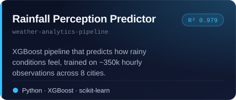
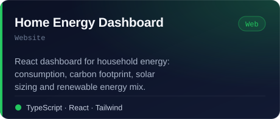

  

 

### About

I'm a fourth-year computer science student. I like taking messy real-world data and turning it into tools people can use, from weather and wildfire models to a desktop app used in cancer treatment planning.

- **Now:** capstone work on [brachify](https://github.com/brachify/brachify), which turns brachytherapy treatment plans into 3D-printable applicators
- **Interests:** applied machine learning, health and climate data, native iOS, clean desktop and web UIs
- **How I work:** start from the question, measure honestly, ship something usable

 

### Toolkit

  

 

### Featured work

  
  
  
  
  
  

 

  

